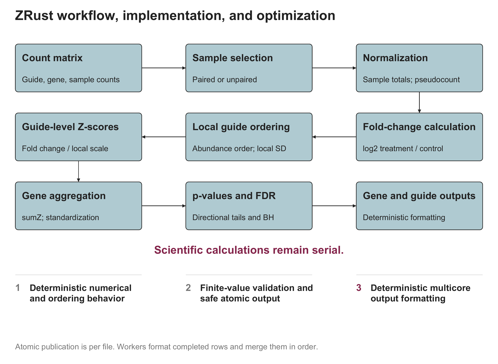
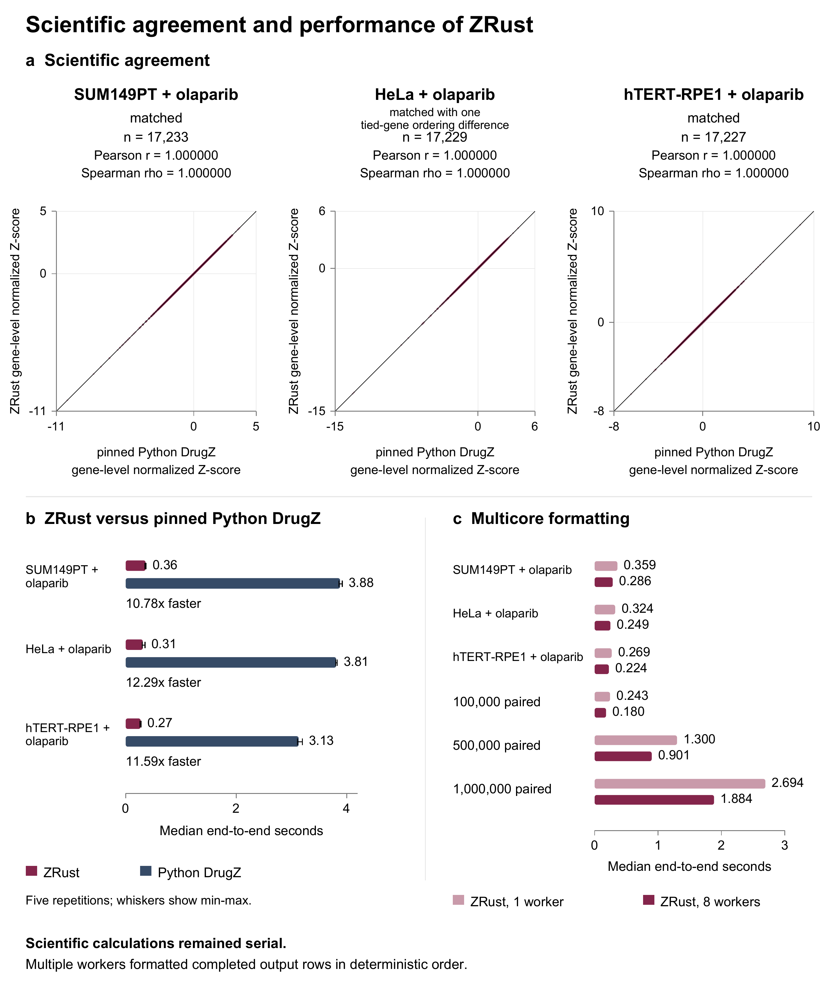

# ZRust

Rust analysis of pooled CRISPR screens for treatment sensitivity and resistance.

**ZRust 0.1.0 is source-only software for Apple Silicon macOS.**

The crate, executable, and command are all named `zrust`. Build the executable locally. No binary distribution or tagged release is provided.

## Documentation

- [ZRust User Manual](docs/ZRust-User-Manual.pdf): installation, first analysis, output columns, and complete command reference.
- [ZRust Manuscript](manuscript/ZRust-Manuscript.pdf): scientific comparisons, performance, methods, and limits.
- [Paired example](examples/paired/README.md): two control-treatment pairs.
- [Unequal-arm unpaired example](examples/unpaired/README.md): two controls and one treatment.
- [Platform scope](docs/PLATFORM-SUPPORT.md) and [third-party notices](NOTICES.md).

## What ZRust does

- Runs paired or unpaired DrugZ analysis, including unequal group sizes in unpaired mode.
- Writes gene-level scores and separate sensitization and resistance statistics.
- Can also write guide-level results.

ZRust is an independent Rust reimplementation of DrugZ. It analyzes an existing guide-count matrix. Read counting and biological interpretation remain separate steps.

## How ZRust works

ZRust reads a guide-count matrix and compares control and treatment samples. It follows the core DrugZ analysis while adding strict input checks, safe result-file writing, and faster output preparation.



*Figure 1. ZRust workflow, implementation, and optimization.*

Scientific calculations remain single-threaded. For large result files, ZRust can use several CPU workers to prepare completed rows for writing.

We next compared ZRust with pinned Python DrugZ to confirm that the faster implementation preserved the expected scientific results.

## Validation and performance

On the tested macOS ARM64 workstation, ZRust was **10.8 to 12.3 times faster than pinned Python DrugZ** on three published olaparib screens. That comparison used serial output formatting. The SUM149PT olaparib screen and hTERT-RPE1 olaparib screen matched across tested result fields. The HeLa olaparib screen had one tied-gene ordering difference, with unchanged statistical results and significant-gene membership. Correlation alone does not establish agreement. See the [ZRust manuscript](manuscript/ZRust-Manuscript.pdf) for the complete comparison.



*Figure 2. Scientific agreement and performance benchmarks.*

These observations apply to the tested workstation and workloads. They do not imply a universal speedup.

## Requirements and installation

Use an Apple Silicon Mac, Git, Rust/Cargo, and Apple command-line developer tools.
Source use is qualified only for macOS ARM64 (`aarch64-apple-darwin`). Rust/Cargo 1.98.0 was tested; a lower minimum version has not been established. Python 3 is needed only for fixture verification and a test. It is not needed to run an analysis. See the manual for installation steps.

Clone into a new folder. Run these commands in Terminal, one line at a time. Start outside an existing folder named `zrust`.

<!-- command: readme-install -->
```sh
git clone https://github.com/Yoonecorn/ZRust.git zrust
cd zrust
unset CARGO_TARGET_DIR
cargo build --release --locked
target/release/zrust --version
```

Expected version: `ZRust 0.1.0`. Cargo downloads the exact dependencies in `Cargo.lock` if they are not already cached. No Python scientific packages or numerical system libraries are needed. `unset CARGO_TARGET_DIR` keeps the executable in the path shown here.

## Verify the source checkout

After building ZRust, run these commands from the repository root:

<!-- command: readme-checks -->
```sh
cargo test --locked
python3 tools/release/verify_fixtures.py
target/release/zrust --help
```

## Quick start: paired analysis

Run from the cloned repository root. The included counts are synthetic teaching data, not an olaparib experiment. The output folder must be new.

<!-- command: readme-paired -->
```sh
mkdir results-paired
target/release/zrust -i examples/paired/counts.tsv -c C1,C2 -x T1,T2 \
  --half_window_size 5 -q \
  -o results-paired/genes.tsv -f results-paired/guides.tsv
head -n 3 results-paired/genes.tsv
```

`C1` pairs with `T1`; `C2` pairs with `T2`. Success creates both result files and returns to the prompt. `-q` suppresses progress messages, but keeps errors. The small teaching input needs the shown half-window value; do not transfer it to a biological study without assessing the analysis settings.

## Count-matrix format

Use a UTF-8 text file with actual tabs between columns. TSV means tab-separated values. The first column contains unique guide identifiers. The second contains gene names. Every remaining column has a unique sample name and counts. Gene names can repeat. Do not use a comma-separated spreadsheet export.

```text
sgRNA  Gene  C1    C2    T1   T2
g000   G00   1000  1000  828  889
```

The spaces above show the layout only. Use the real tab-separated [example file](examples/paired/counts.tsv). Selected counts must be finite and nonnegative. Selected sample totals must be positive. Sample names are case-sensitive. Do not add spaces around commas in sample lists.

## Unequal-arm unpaired analysis

Unpaired mode compares mean normalized counts within each group. This example has two controls and one treatment. It does not match samples by list position.

<!-- command: readme-unpaired -->
```sh
mkdir results-unpaired
target/release/zrust -i examples/unpaired/counts.tsv -c C1,C2 -x T1 \
  -unpaired --half_window_size 5 --minobs 1 -q \
  -o results-unpaired/genes.tsv -f results-unpaired/guides.tsv
head -n 3 results-unpaired/genes.tsv
```

## Output files

Gene output contains `GENE`, `sumZ`, `numObs`, `normZ`, `pval_synth`, `rank_synth`, `fdr_synth`, `pval_supp`, `rank_supp`, and `fdr_supp`. Negative `normZ` points toward sensitization; positive `normZ` points toward resistance. Read the matching directional p-value and false discovery rate (FDR). These statistics do not replace replication or biological controls.

`-o` selects the gene result file. `-f` adds the guide result file. Guide columns differ between paired and unpaired analyses. The manual explains every column. ZRust can replace existing destination files. Use a new output folder for each analysis. Each file is protected separately; two files are not updated as one transaction.

## Main command options

| Option | Meaning |
| --- | --- |
| `-i FILE` | Input counts; default is standard input. |
| `-c LIST` | Required control names, separated by commas. |
| `-x LIST` | Required treatment names, separated by commas. |
| `-o FILE` | Gene results; default is standard output. |
| `-f FILE` | Optional guide results. |
| `-unpaired` | Compare group means instead of paired samples. |
| `-p INTEGER` | Pseudocount; default 5, minimum 0. |
| `--half_window_size INTEGER` | Local half-window; default 500, minimum 1. |
| `--minobs INTEGER` | Minimum nonzero guide observations per gene; default 1. |
| `-r LIST` | Exclude these gene names before normalization. |
| `--threads INTEGER` | Output workers; default 8, maximum used 8. |
| `-q` | Hide progress messages, but retain errors. |
| `-I 0` | Guide identifier column; only 0 is supported. |
| `-h`, `--help` | Help. |
| `-V`, `--version` | Version. |

## Threads

Scientific calculations remain single-threaded. Multiple workers prepare completed output rows for writing. Eight formatting workers are the qualified default. Values above eight are capped at eight. `--threads 1` requests one formatting worker. Small outputs stay serial below 25,000 gene rows or 50,000 guide rows. More workers do not guarantee a faster run.

## Current limits

Validation is limited to source use on macOS ARM64. Intel Mac, Linux, and Windows are not qualified. The largest tested input had one million guides. Small or uniform inputs can have undefined local variation and must be corrected at the study-design or input stage. Do not change data just to force a result. No new benchmark or biological finding is claimed here.

## Citation and license

No ZRust DOI or published manuscript citation is assigned. For now, identify ZRust 0.1.0, the [repository](https://github.com/Yoonecorn/ZRust), and the exact commit used. Cite the DrugZ method: [Colic et al., Genome Medicine (2019)](https://doi.org/10.1186/s13073-019-0665-3).

Licensed under [MIT](LICENSE). [NOTICES.md](NOTICES.md) preserves upstream attribution. ZRust is independent and is not endorsed by the DrugZ authors.
